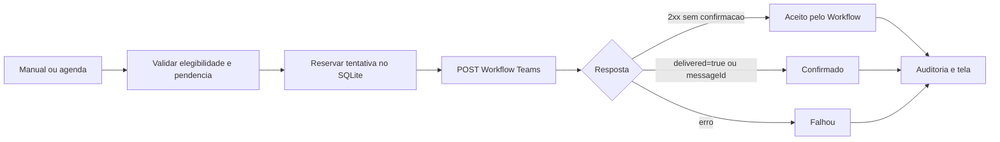

# Arquitetura - estado atual v0.0.19

```text
Navegador
   |
   v
ASP.NET Core MVC / IIS
   |
   +--> AD: autenticacao, autorizacao administrativa e usuarios elegiveis
   |
   +--> SQLite
   |      +--> treinamentos / questoes / conclusoes
   |      +--> exclusoes permanentes
   |      +--> TeamsReminderHistory
   |      `--> TrainingReminderSchedules
   |
   +--> Teams Workflow: { recipient, text }
   |      `--> resposta opcional de confirmacao { success, delivered, workflowRunId, messageId }
   |
   +--> TeamsReminderWorker (15 min)
   |      `--> somente agenda explicitamente ativada
   |
   `--> Sistema de arquivos persistente
          +--> Data\Automind.Treinamentos.db
          +--> Treinamentos\<slug>\<versao>\manifest.json + SHA256.txt
          +--> Evidencias\Colaboradores\<login>\*.pdf
          +--> Evidencias\Relatorios\*.pdf
          +--> Logs\Audit-*.jsonl
          `--> Backup\
```

## Componentes

- `AccountController`: login/logout AD.
- `TrainingController`: area do colaborador, execucao, aceite e evidencias.
- `AdminController`: administracao, pendencias, exclusoes, envio manual e configuracao da agenda Teams.
- `AdAuthenticationService`: credenciais e revalidacao de conta.
- `AdAdminAuthorizationService`: membership atual do grupo `_treinamentos`, fail-closed.
- `AdDirectoryService`: usuarios AD habilitados/elegiveis.
- `TrainingRepository`: persistencia SQLite, inclusive historico/agenda Teams.
- `TeamsWebhookService`: POST ao Workflow e classificacao do retorno em aceite, confirmacao ou falha.
- `TeamsReminderService`: reserva a tentativa no banco antes do envio, finaliza o resultado e audita.
- `TeamsReminderWorker`: executa ciclos automaticos vencidos sem depender de acesso a pagina.
- `AuditService`: auditoria JSONL diaria; registros antigos de Teams sao usados para reconstruir o historico sem reenvio.
- `TrainingSnapshotService`, `EvidenceService`, `SimplePdfService` e `StorageService`: comportamento anterior preservado.

## Fluxo de lembrete Teams

```text
Administrador seleciona usuario OU agenda vence
  -> confirmar elegibilidade / pendencia / exclusao
  -> reservar tentativa em TeamsReminderHistory
  -> POST no Workflow
  -> receber resultado
  -> gravar status final
  -> registrar Audit-*.jsonl
  -> exibir ultimo estado na tela Pendencias
```



## Regra de agenda

A agenda e desativada por padrao e configurada por treinamento publicado. O primeiro ciclo ocorre somente depois do intervalo escolhido. Em cada ciclo, o worker ignora concluidos, excluidos e usuarios que receberam aviso valido dentro do intervalo. Uma chave unica por ciclo/usuario impede repeticao do mesmo ciclo apos reinicio.

## Confirmacao x leitura

`Confirmado` significa confirmacao retornada pelo Workflow para a etapa de postagem no Teams. Nao significa que o colaborador abriu ou leu a mensagem.

## Persistencia e ambiente

Development usa `Storage:RootPath=App_Data`; Production usa `C:\Automind.Treinamentos`. O banco continua sendo a fonte de verdade das conclusoes. Para a agenda executar continuamente no IIS, o App Pool precisa permanecer ativo; essa configuracao de ambiente e validada separadamente e nao e alterada pelo codigo.

## Autorizacao administrativa

A role administrativa nao e confiada ao cookie. A membership `_treinamentos` e consultada no AD e adicionada somente em memoria no request antes de `UseAuthorization`.
