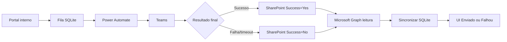

# v0.0.23 - Teams + SharePoint - fluxo completo de status

## Objetivo

Registrar o resultado final do envio Teams na nuvem e permitir que o portal interno reconcilie esse resultado sem expor `treinamentos.automind.com.br` para a Internet.

Arquitetura aprovada:

```text
Portal interno
  -> fila SQLite
  -> Power Automate
  -> Teams
  -> SharePoint Online
  -> Microsoft Graph (somente leitura)
  -> Portal interno / SQLite
```

O portal continua HTTP e interno. O trafego novo para Microsoft 365 e somente de saida via HTTPS.

## URLs e identificadores operacionais

Portal interno:

```text
http://treinamentos.automind.com.br
```

SharePoint - site:

```text
https://automindautomacao.sharepoint.com/sites/GSTI-NOC
```

SharePoint - lista de status:

```text
https://automindautomacao.sharepoint.com/sites/GSTI-NOC/Lists/AutomindTreinamentosTeamsStatus/AllItems.aspx
```

Lista:

```text
AutomindTreinamentosTeamsStatus
```

Power Automate - fluxo atual:

```text
Nome: Treinamento Automind
Flow ID: b637f2a0-9f0d-4a0b-b63a-4f5af169fd18
Environment path: Default-9ab05ca8-1779-410b-ae61-82dbd20810f3
```

URL administrativa do fluxo:

```text
https://make.powerautomate.com/environments/Default-9ab05ca8-1779-410b-ae61-82dbd20810f3/flows/b637f2a0-9f0d-4a0b-b63a-4f5af169fd18
```

A URL real do gatilho/webhook do fluxo e segredo e NAO deve ser gravada em Git, docs, banco ou logs.

## Lista SharePoint

Colunas usadas:

| Campo | Tipo | Regra |
| --- | --- | --- |
| `Title` | Single line of text | Semantica: `RequestId`; obrigatorio e unico |
| `Recipient` | Single line of text | E-mail/UPN; obrigatorio |
| `Success` | Yes/No | `Yes` para envio final confirmado; `No` para falha final |
| `SentAtUtc` | Date and time | Preenchido no sucesso; vazio na falha |
| `WorkflowRunId` | Single line of text | ID da execucao do Power Automate |
| `MessageId` | Single line of text | ID retornado pela acao Teams no sucesso |
| `Error` | Multiple lines of text | Plain text; motivo de falha |

Observacao: `Title` e o nome interno confiavel do SharePoint. Mesmo que a interface seja renomeada para `RequestId`, o Power Automate e o portal podem continuar tratando o campo interno como `Title`.

## Power Automate - desenho atual

```text
Quando uma solicitacao de webhook do Teams e recebida
  -> Analisar JSON
  -> Postar mensagem em um chat ou canal
       |-> SUCESSO -> Criar item
       `-> FALHA/TIMEOUT -> Criar item 1
```

### Trigger

Controle de simultaneidade:

```text
Ativado
Grau de paralelismo: 1
```

O portal tambem controla cadencia e envia uma tentativa por vez, com intervalo padrao de 13 segundos.

### Analisar JSON

Conteudo: `Corpo` do trigger.

Schema atual:

```json
{
  "type": "object",
  "properties": {
    "recipient": { "type": "string" },
    "text": { "type": "string" },
    "requestId": { "type": "string" },
    "callbackToken": { "type": "string" },
    "callbackUrl": { "type": "string" }
  },
  "required": ["recipient", "text", "requestId", "callbackToken", "callbackUrl"]
}
```

`callbackToken` e `callbackUrl` sao campos de compatibilidade com a v0.0.22. O fluxo v0.0.23 nao faz POST de callback para o portal. Esses campos podem ser removidos em uma revisao futura somente se portal e schema forem alterados juntos.

### Postar mensagem em um chat ou canal

Recebe o destinatario e o HTML produzido pelo portal.

Mensagem atual:

```text
Ola, Daniel. Voce possui o treinamento Treinamento de Conscientizacao em Seguranca da Informacao pendente.
Tempo estimado: 8 minutos.
Este e um ambiente interno, entao esteja conectado a VPN.
Acessar treinamento: http://treinamentos.automind.com.br/Training/Start/1
```

No payload real o titulo e o rotulo do link usam HTML e o link continua HTTP interno.

### Caminho de sucesso - Criar item

Executa quando `Postar mensagem em um chat ou canal` teve exito.

Mapeamento:

```text
Title        = body('Analisar_JSON')?['requestId']
Recipient    = body('Analisar_JSON')?['recipient']
Success      = Sim
SentAtUtc    = utcNow()
WorkflowRunId= workflow()?['run']?['name']
MessageId    = body('Postar_mensagem_em_um_chat_ou_canal')?['id']
Error        = vazio
```

### Caminho de falha - Criar item 1

`Executar apos` deve observar diretamente `Postar mensagem em um chat ou canal`.

Marcar somente:

```text
Atingiu o tempo limite = SIM
Teve falha             = SIM
Teve exito             = NAO
Foi ignorado           = NAO
```

Mapeamento:

```text
Title        = body('Analisar_JSON')?['requestId']
Recipient    = body('Analisar_JSON')?['recipient']
Success      = Nao
SentAtUtc    = vazio
WorkflowRunId= workflow()?['run']?['name']
MessageId    = vazio
Error        = Falha ou timeout no envio ao Teams
```

## Caminhos no pacote v0.0.23

Implementacao do envio/fila existente:

```text
Services/TeamsWebhookService.cs
Services/TeamsReminderService.cs
Services/TeamsReminderDispatchWorker.cs
Services/TrainingRepository.cs
Models/TeamsReminderModels.cs
```

Implementacao nova de consulta/reconciliacao SharePoint:

```text
Services/TeamsStatusSharePointService.cs
Services/TeamsReminderStatusSynchronizer.cs
Services/TeamsReminderStatusSyncWorker.cs
Controllers/AdminController.cs
Views/Admin/Pending.cshtml
```

Registro/configuracao de servicos:

```text
Program.cs
Services/Options.cs
appsettings.json
appsettings.Production.json
appsettings.Production.example.json
```

Persistencia local do status:

```text
SQLite -> TeamsReminderHistory
RequestId -> chave de correlacao entre SQLite e SharePoint Title
```

Documentacao operacional:

```text
docs/49-TEAMS-FILA-CALLBACK-V0.0.22.md     # historico/rollback
docs/50-TEAMS-SHAREPOINT-STATUS-V0.0.23.md # fluxo atual completo
docs/51-CONFIGURACAO-GRAPH-IIS-V0.0.23.md # identidade Graph/IIS
docs/52-TESTE-V0.0.23.md                  # roteiro/evidencias de validacao
```

## Portal - fila e envio

1. O administrador seleciona um pendente.
2. O portal cria `TeamsReminderHistory` com status `queued`, `RequestId` unico e `CallbackToken` unico.
3. `TeamsReminderDispatchWorker` reivindica a proxima tentativa e muda para `processing`.
4. O portal chama o Workflow HTTPS.
5. HTTP 2xx/202 significa apenas que o Power Automate aceitou a execucao.
6. O portal NAO promove para `sent` nesse momento.
7. O Power Automate conclui a acao Teams e grava o resultado final no SharePoint.
8. O portal le o registro no SharePoint pelo `RequestId` e atualiza o SQLite para `sent` ou `failed`.

Cadencia padrao:

```text
Automind:Teams:DispatchIntervalSeconds = 13
```

Enquanto a tentativa local estiver `queued` ou `processing`, o indice unico ativo impede novo envio para o mesmo treinamento/colaborador.

## Portal - sincronizacao SharePoint

A v0.0.23 adiciona:

```text
TeamsStatusSharePointService
TeamsReminderStatusSynchronizer
TeamsReminderStatusSyncWorker
```

O worker roda periodicamente e consulta apenas tentativas locais ainda abertas.

A pagina `Administracao > Pendencias` tambem executa uma reconciliacao antes de montar os status, permitindo refletir rapidamente um resultado que ja existe no SharePoint.

Fluxo:

```text
SQLite queued/processing
  -> RequestId
  -> Microsoft Graph
  -> GSTI-NOC / AutomindTreinamentosTeamsStatus
  -> localizar fields/Title == RequestId
  -> Success=true  -> SQLite sent
  -> Success=false -> SQLite failed
```

O SQLite continua sendo a fonte usada pela UI e pela agenda. O SharePoint e a fonte de confirmacao externa do resultado final do Teams.

## Estados exibidos

```text
sem tentativa final    -> Nao enviado
queued/processing      -> Enviando
ultimo sucesso existe  -> Enviado
falha sem sucesso      -> Falhou
```

`Enviado` nao significa leitura da mensagem; significa somente que a acao do Teams foi concluida e o Power Automate registrou o resultado final.

## Caminhos de falha

### Portal nao consegue chamar o Workflow

Resultado local:

```text
failed
```

Nenhum registro SharePoint e esperado.

### Workflow aceitou, Teams ainda executando

Resultado local:

```text
processing / Enviando
```

Nao reenviar. O bloqueio ativo evita duplicidade.

### Teams finaliza com sucesso

```text
Teams -> SharePoint Success=Yes -> sync Graph -> SQLite sent -> UI Enviado
```

### Teams finaliza com falha/timeout

```text
Teams -> SharePoint Success=No -> sync Graph -> SQLite failed -> UI Falhou
```

### SharePoint/Graph indisponivel

A tentativa fica `processing`. O portal nao inventa sucesso e nao libera reenvio enquanto o resultado nao for reconciliado.

Quando a leitura voltar, o worker tenta novamente.

## Callback legado v0.0.22

Endpoint ainda presente para compatibilidade/rollback:

```text
POST /api/teams/reminder-result
```

Na arquitetura v0.0.23 ele NAO e caminho ativo e o Power Automate nao precisa alcancar `treinamentos.automind.com.br`.

Nao publicar DNS, binding ou porta do portal na Internet para fazer callback.

## Seguranca

- portal permanece interno;
- link de treinamento permanece HTTP interno por decisao atual;
- usuario deve estar conectado a VPN para acessar o portal fora da rede local;
- webhook Power Automate permanece segredo externo;
- credencial Graph permanece segredo externo;
- Graph usa HTTPS;
- permissao recomendada: `Sites.Selected` com papel `read` apenas no site `GSTI-NOC`;
- nao usar `Sites.Read.All`/`Sites.ReadWrite.All` se `Sites.Selected` estiver disponivel;
- nunca versionar ClientSecret, token OAuth ou URL real do webhook.

## Mermaid



## Evidencia validada em 2026-10-22

`VALIDADO NO AMBIENTE` para o caminho de sucesso:

- Workflow executou com exito;
- acao Teams executou com exito;
- `Criar item` executou com exito;
- `Criar item 1` foi ignorado corretamente;
- item foi criado em `AutomindTreinamentosTeamsStatus` com Success marcado, SentAtUtc, WorkflowRunId e MessageId;
- mensagem chegou no Teams.

`PENDENTE DE VALIDACAO`:

- caminho real de falha/timeout;
- leitura Graph do portal v0.0.23 no IIS apos configuracao da identidade de aplicativo.
