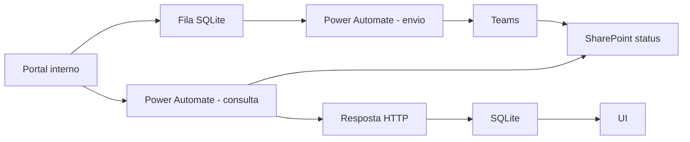

# v0.0.24 - Teams + SharePoint + Power Automate de consulta

## Objetivo

Manter o portal `Automind.Treinamentos` somente na rede interna, registrar o resultado final de cada envio Teams no SharePoint Online e permitir que o portal consulte esse resultado sem Microsoft Graph, App Registration ou callback publico para o IIS.

## Fluxo vigente

```text
Portal interno
  -> fila SQLite (RequestId unico por tentativa)
  -> Power Automate: Treinamento Automind
  -> Teams
  -> SharePoint: AutomindTreinamentosTeamsStatus
  -> Power Automate: Automind.Treinamentos - Consultar Status Teams
  -> Portal interno / SQLite
  -> UI Enviado/Falhou + data/hora
```



## URLs e caminhos administrativos

Portal interno:

```text
http://treinamentos.automind.com.br
```

SharePoint - site:

```text
https://automindautomacao.sharepoint.com/sites/GSTI-NOC
```

SharePoint - lista:

```text
https://automindautomacao.sharepoint.com/sites/GSTI-NOC/Lists/AutomindTreinamentosTeamsStatus/AllItems.aspx
```

Lista:

```text
AutomindTreinamentosTeamsStatus
```

Power Automate - fluxo de envio:

```text
Nome: Treinamento Automind
Flow ID: b637f2a0-9f0d-4a0b-b63a-4f5af169fd18
Environment: Default-9ab05ca8-1779-410b-ae61-82dbd20810f3
```

Power Automate - fluxo de consulta:

```text
Nome: Automind.Treinamentos - Consultar Status Teams
Criacao: Meus fluxos -> Novo fluxo -> Fluxo da nuvem instantaneo
Trigger: Solicitacao -> Quando uma solicitacao HTTP for recebida
Quem pode disparar: Alguem
```

A URL HTTP gerada pelo trigger e segredo operacional. Ela NAO deve ser registrada em Git, docs, logs, CHECKPOINT ou screenshots compartilhados. No portal ela entra apenas por configuracao de ambiente:

```text
Automind__TeamsStatus__LookupUrl=<SEGREDO_NO_AMBIENTE>
```

## SharePoint - colunas

| Campo visivel | Nome interno usado | Tipo | Uso |
| --- | --- | --- | --- |
| RequestId | `Title` | Single line of text | correlacao com SQLite |
| Recipient | `Recipient` | Single line of text | destinatario |
| Success | `Success` | Yes/No | resultado final |
| SentAtUtc | `SentAtUtc` | Date and time | hora do envio confirmado |
| WorkflowRunId | `WorkflowRunId` | Single line of text | execucao Power Automate |
| MessageId | `MessageId` | Single line of text | ID da mensagem Teams |
| Error | `Error` | Multiple lines of text | motivo da falha |

`RequestId` foi criado renomeando a coluna padrao `Title`; por isso o filtro OData usa o nome interno `Title`.

## Fluxo de envio - Treinamento Automind

```text
Quando uma solicitacao de webhook do Teams e recebida
  -> Analisar JSON
  -> Postar mensagem em um chat ou canal
       |-> sucesso -> Criar item no SharePoint
       `-> falha/timeout -> Criar item 1 no SharePoint
```

O trigger permanece com concorrencia habilitada e grau de paralelismo 1. O portal tambem despacha a fila com intervalo padrao de 13 segundos.

O resultado SharePoint de sucesso grava `Success=Sim`, `SentAtUtc=utcNow()`, `WorkflowRunId` e `MessageId`. O caminho de falha grava `Success=Nao` e `Error`.

## Fluxo de consulta - Automind.Treinamentos - Consultar Status Teams

### Trigger HTTP

Schema:

```json
{
  "type": "object",
  "properties": {
    "requestId": { "type": "string" }
  },
  "required": ["requestId"]
}
```

### SharePoint -> Obter itens

```text
Site: GSTI-NOC - https://automindautomacao.sharepoint.com/sites/GSTI-NOC
Lista: AutomindTreinamentosTeamsStatus
Consulta de Filtro: concat('Title eq ''', triggerBody()?['requestId'], '''')
Contagem Superior: 1
```

### Condicao

```text
length(body('Obter_itens')?['value']) > 0
```

### Verdadeiro -> Solicitacao / Resposta

HTTP 200, `Content-Type: application/json`.

Contrato:

```json
{
  "found": true,
  "requestId": "<requestId>",
  "recipient": "<recipient>",
  "success": true,
  "sentAtUtc": "<UTC>",
  "workflowRunId": "<run>",
  "messageId": "<message>",
  "error": ""
}
```

### Falso -> Solicitacao / Resposta

HTTP 200:

```json
{
  "found": false,
  "requestId": "<requestId>"
}
```

## Reenvio manual

Regra vigente a partir da v0.0.24:

- o botao manual fica disponivel sempre que a integracao Teams estiver configurada;
- `queued`/`processing` nao bloqueiam outro clique manual;
- cada clique cria novo `RequestId` e nova linha em `TeamsReminderHistory`;
- a fila continua sendo despachada uma tentativa por vez, com intervalo padrao de 13 segundos;
- a agenda automatica continua protegida por `CycleKey` contra repeticao do mesmo ciclo;
- `Enviado em` mostra a data/hora do ultimo envio confirmado (`sent`), convertida para o horario local pelo frontend.

A migration `0.0.24` remove somente o indice `UX_TeamsReminderHistory_Active`, que era o bloqueio de uma unica tentativa `queued/processing` por colaborador/treinamento. O indice unico de `RequestId` e a protecao `CycleKey` permanecem.

## Caminhos no codigo v0.0.24

```text
Services/TeamsStatusSharePointService.cs
Services/TeamsReminderStatusSynchronizer.cs
Services/TeamsReminderStatusSyncWorker.cs
Services/TeamsReminderService.cs
Services/TeamsReminderDispatchWorker.cs
Services/TeamsWebhookService.cs
Services/TrainingRepository.cs
Data/DatabaseInitializer.cs
Views/Admin/Pending.cshtml
Program.cs
Services/Options.cs
```

## Seguranca

- portal continua sem exposicao publica;
- nenhuma chamada da nuvem entra no IIS;
- URL do fluxo de envio e URL do fluxo de consulta sao segredos e ficam fora de Git/docs/logs;
- SharePoint continua privado e e acessado pela conexao autenticada do proprio Power Automate;
- nenhum App Registration/ClientSecret e necessario no portal para este desenho.
